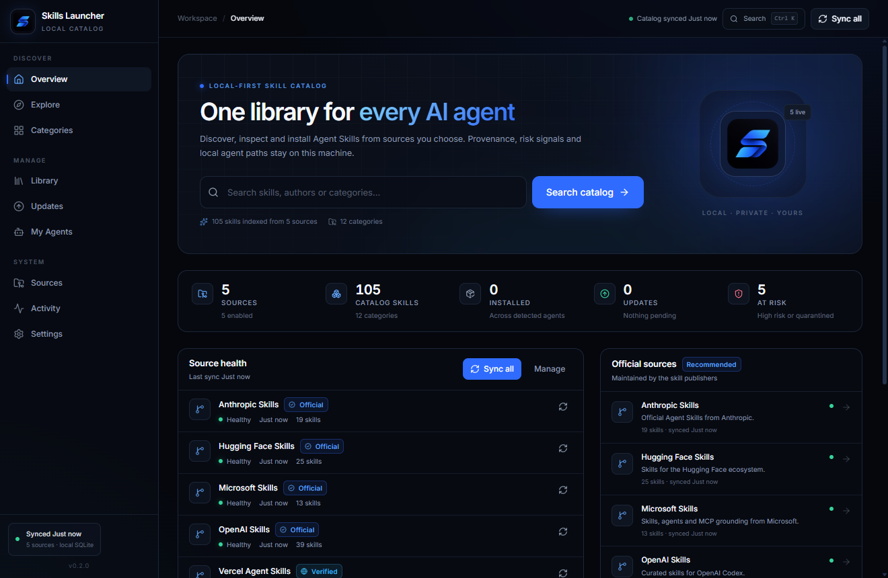

# Skills Launcher

[](https://github.com/RodrigoKuerten/skills-launcher/actions/workflows/cross-platform.yml)

One library for every AI agent. Skills Launcher is a desktop-first universal skills manager: discover skills from
verifiable sources, inspect provenance and security findings, install them into the agents you actually have, and keep
them current with backups and rollback.

[](docs/USER_GUIDE.md)

> Automated scans are heuristics, not a security guarantee. Compatibility badges describe Agent Skills format support,
> not a promise that a specific agent build will load every field. CI validates the real Tauri window on Ubuntu 24.04,
> Ubuntu 26.04 and macOS, plus real detection/install paths for all seven agents; click-through GUI and packaged
> installers there still need validation.

## Documentation

Start with the **[User Guide with screenshots](docs/USER_GUIDE.md)**. It covers every screen and workflow: Home, Explore,
Categories, skill detail, risk explanations, installation, Library, Updates, My Agents, Sources, import/export,
Downloads, Settings, themes, security, and troubleshooting.

| Guide | What it covers |
|---|---|
| [User Guide](docs/USER_GUIDE.md) | Step-by-step usage with screenshots of every feature |
| [Sources](docs/SOURCES.md) | Adapters, seeded catalogs, limits, and scanner rules |
| [Agents](docs/AGENTS.md) | Detection evidence, host paths, install/backup/rollback |
| [Security](docs/SECURITY.md) | Trust boundaries, path protections, and residual risks |
| [Releases](docs/RELEASES.md) | Release assets, checksums, and publishing workflow |
| [CI](docs/CI.md) | Ubuntu 24.04/26.04, macOS, Windows, and seven-agent evidence |
| [Design audit](docs/AUDIT.md) | Playwright screenshots and UI findings |
| [Desktop plan](docs/DESKTOP_PLAN.md) | Scope, architecture boundaries, and acceptance checks |
| [IPC contract](docs/IPC_CONTRACT.md) | Desktop command contract |

## Desktop app (primary product)

Built with Tauri 2, React 19, TypeScript, Tailwind CSS 4, Rust and SQLite. The desktop app does **not** require Node,
the web app, or the legacy companion to run.

```bash
npm install
npm run dev:desktop      # Vite + Tauri dev window
npm run build:desktop    # Windows NSIS installer under apps/desktop/src-tauri/target/release/bundle
```

The Windows build needs Rust and the MSVC C++ build tools. `scripts/tauri-with-msvc.mjs` imports `vcvars64.bat` so a
normal shell can build.

### What the desktop app does

- **Catalog**: SQLite with sources, immutable versions, provenance, categories, trust, risk/security findings and
  compatibility; search, filters and sorts.
- **Sources**: 23 seeded verified catalogs plus extensible Rust adapters for GitHub repositories, GitHub organizations,
  local directories, ZIP files, HTTPS Git repositories and versioned HTTP JSON catalogs. Add/edit/remove/enable/disable/sync, auto-sync and JSON
  import/export.
- **Agents**: evidence-based detection for Claude Code, OpenAI Codex, OpenCode, Cursor, GitHub Copilot, Gemini CLI and
  Windsurf / Devin Desktop. A config folder alone is never treated as an installation; supported agents in
  non-standard locations can be added manually with a user-selected skills folder.
- **Install lifecycle**: one-click install to one or many detected agents, update, uninstall, backup, rollback and an
  operation log. Existing untracked user files survive updates; old managed files are removed.
- **Security**: imported content is untrusted data. Paths are validated, symlinks/reparse points and ZIP traversal are
  rejected, archives and files are size-capped, static findings are stored per version, suspicious versions require an
  explicit override, and imported scripts are never executed.
- **UI**: dark-first Home, Explore, Categories, Library, Updates, My Agents, Sources, Activity and Settings using the
  blue ribbon “S” logo and palette.

The local database and backups live in the Tauri app-data directory. GitHub tokens are held in memory for the current
session only; they are never written to SQLite.

### Repository layout

```
apps/desktop/          Tauri 2 + React desktop app (primary)
  src/                 React UI
  src-tauri/           Rust backend, adapters, SQLite, install engine
apps/web/              optional Next.js marketplace/reference implementation (legacy companion flow)
apps/agent/            legacy Node companion for the web app; not used by desktop
packages/core/         TypeScript reference domain logic; not imported by Rust
docs/                  plan, sources, agents, IPC contract, research and ADRs
```

### Tests and verification

```bash
npm run typecheck -w @skills-launcher/desktop
npm run ui:build -w @skills-launcher/desktop
cd apps/desktop/src-tauri
cargo test
```

Rust tests cover local catalog sync, prompt-injection quarantine, install/update with user extras and backups, rollback,
ZIP traversal, path validation and private-address rejection. Network smoke tests are opt-in (`--ignored`).

## Optional web marketplace

The original Next.js marketplace and Node companion remain in the repository as a reference/optional remote catalog.
They are not a prerequisite for the desktop app and are not migrated into the desktop database automatically.

```bash
npm run db:push
npm run db:seed
npm run dev              # http://localhost:3000
```

Legacy companion commands (`npm run agent`, `npm run agent:cli`) still exist for the web application. Desktop installs
do not use the loopback companion.

## License

Application code: MIT. Imported skills retain their original licenses and attribution; check each skill’s source and
license before redistributing it.
