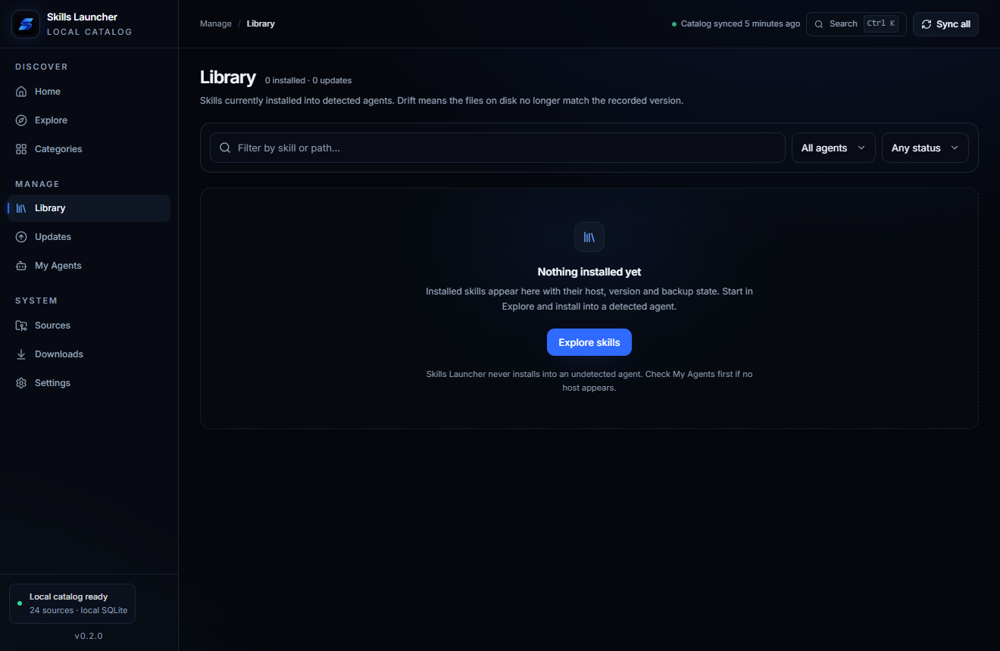

# Guia de uso — Skills Launcher

Este guia mostra cada área do aplicativo com prints reais do desktop. Os prints podem mostrar contagens diferentes
das suas, porque o catálogo local cresce conforme as fontes são sincronizadas.

## Primeiros passos

1. Abra **Sources** e sincronize as fontes que deseja.
2. Abra **Explore**, pesquise e inspecione um skill.
3. Abra **My Agents** e confirme qual agente foi detectado.
4. No detalhe do skill, selecione o agente e clique em **Install on …**.
5. Acompanhe instalações, atualizações e remoções em **Downloads**.

> O Skills Launcher nunca executa código, scripts, hooks ou comandos de um skill importado. Ele valida, escaneia e
> copia arquivos para o diretório do agente escolhido.

## Home

A Home concentra o estado do catálogo, a saúde das fontes, skills em destaque e as operações recentes.

- **Sync all**: sincroniza todas as fontes habilitadas.
- **Sources / Catalog skills / Installed / Updates / At risk**: visão rápida do catálogo.
- **Source health**: mostra fontes saudáveis, com erro ou nunca sincronizadas.
- **Featured skills**: atalhos para skills de maior qualidade.
- **Recent operations**: últimas sincronizações, instalações, atualizações e remoções.

## Explore

Use **Explore** para pesquisar e filtrar o catálogo inteiro.

- Pesquise por nome, resumo, autor ou conteúdo indexado.
- Filtre por categoria, fonte, agente, confiança e risco.
- **Include quarantined** mostra versões bloqueadas pelo scanner.
- O seletor de ordenação alterna entre qualidade, recentes, nome, estrelas e segurança.
- Clique em um card para abrir o detalhe do skill.

### Busca

A busca é local e não envia sua consulta para nenhum servidor. Use `Ctrl K` no Windows/Linux ou `Cmd K` no macOS para
focar a busca a partir de outras telas.

## Categorias

**Categories** agrupa o catálogo por área e permite chegar ao Explore já filtrado.

Categorias sem skills não são apresentadas como atalhos clicáveis vazios.

## Detalhe do skill

O painel lateral mostra tudo antes de instalar.

- **Trust / Risk / category**: procedência, risco e classificação.
- **Install targets**: somente agentes com evidência de runtime aparecem. Selecione um ou mais.
- **Provenance**: versão, licença, autor, estrelas, fonte, atualização e repositório.
- **Scan findings**: achados do scanner; clique no badge de risco para entender a escala.
- **Agent compatibility**: compatibilidade conhecida com o formato Agent Skills.
- **Install on …**: instala no agente selecionado. O texto muda para **Reinstall** quando já existe uma instalação.

### Explicação do risco

Clique em qualquer badge de risco, inclusive nos cards e nos findings.

O diálogo mostra:

- o nível atual;
- o que Low, Medium, High e Critical significam;
- o efeito na instalação;
- como o scanner escolhe o nível;
- o aviso de que a análise é heurística.

`High` exige liberar explicitamente a instalação. `Critical` fica em quarentena e a UI bloqueia a instalação.

## Instalar um skill

1. Abra o detalhe do skill.
2. Confira procedência, licença e findings.
3. Selecione um agente detectado em **Install targets**.
4. Clique em **Install on …**.
5. Abra **Library** para confirmar.

O instalador cria um backup quando substitui uma pasta existente, faz staging, troca os arquivos e só então atualiza o
banco. Arquivos extras não gerenciados pelo app são preservados em updates.

## Library

**Library** mostra o que está instalado, onde e em qual versão.

Cada instalação oferece:

- **Update**, quando existe uma versão mais nova;
- **Rollback/backups**, para restaurar uma versão anterior;
- **Uninstall**, com opção de manter ou remover os arquivos instalados.

O uninstall mantém o histórico e pode criar backup antes de remover arquivos.

## Updates

**Updates** compara instalações com a versão mais recente de cada skill.

- **Check again** refaz a verificação.
- Selecione uma ou várias atualizações e use **Update selected**.
- Versões em quarentena ou com risco alto/crítico não são atualizadas automaticamente.

## My Agents

**My Agents** mostra somente agentes com evidência real de runtime.

Cada agente detectado exibe:

- executável e versão;
- configuração encontrada;
- raiz de skills do usuário;
- raiz de skills do projeto;
- notas de evidência;
- switch **Auto-update**.

Use **Rescan** depois de instalar ou remover um agente. Pasta de configuração sozinha não conta como agente detectado.

Agentes suportados: Claude Code, OpenAI Codex, OpenCode, Cursor, GitHub Copilot, Gemini CLI e Windsurf/Devin Desktop.

## Sources

**Sources** é onde o catálogo é alimentado. Cada source mantém sua procedência.

- **Add source**: adiciona uma fonte.
- **Import / export**: troca a configuração das fontes entre instalações.
- Ícone de sincronização: sincroniza somente aquela fonte.
- Switch: habilita/desabilita a fonte.
- Lápis: edita nome, URL, branch, caminho, confiança e política de sync.
- Lixeira: remove a fonte do catálogo sem apagar skills já instalados.

### Adicionar ou editar fonte

Tipos disponíveis:

| Tipo | Uso |
|---|---|
| GitHub repository | Um repositório público com pastas com `SKILL.md`. |
| GitHub organization | Descobre repositórios públicos de uma organização. |
| Local folder | Uma pasta local, escolhida pelo seletor nativo. |
| ZIP archive | Um arquivo ZIP local, lido em memória. |
| Git repository | Clone raso via Git do sistema. |
| HTTP JSON catalog | Catálogo JSON versionado pelo contrato do app. |

Configure branch/caminho quando o `SKILL.md` não estiver na raiz. **Trust** é uma etiqueta declarada pela fonte, não uma
assinatura de segurança.

### Importar e exportar fontes

O JSON exportado contém nomes, URLs, configuração e trust. Não contém arquivos de skills nem credenciais. Caminhos
locais podem aparecer; revise antes de compartilhar.

## Downloads / Operations

**Downloads** é o diário local de operações.

Acompanhe sincronizações, instalações, atualizações, rollbacks e remoções, com status e horário. Use essa tela para
diagnosticar uma fonte que falhou ou confirmar o resultado de uma operação.

## Settings

- **Appearance**: alterna entre tema escuro e claro.
- **Auto-sync sources**: habilita a atualização periódica das fontes.
- **Auto-sync interval**: intervalo entre 30 e 10.080 minutos.
- **GitHub access**: token opcional para elevar o rate limit. O token fica somente em memória e não é gravado no SQLite.
- **Save changes** aplica as configurações locais.

### Tema claro

### Janela compacta

O layout mínimo suportado é `980x640`; a sidebar compacta aparece quando não há espaço para os rótulos.

## Segurança e riscos

O scanner examina o texto dos skills e procura prompt injection, comandos destrutivos, pedidos de segredos, execução
remota, Unicode escondido e links suspeitos.

- **Low**: nenhuma regra bloqueante encontrada; não é garantia de segurança.
- **Medium**: aviso que não bloqueia a instalação.
- **High**: instalação bloqueada por padrão; exige confirmação explícita.
- **Critical**: versão em quarentena; a UI bloqueia a instalação.

O score de 0 a 100 é independente do nível. O scanner é heurístico e não substitui revisar o conteúdo e a origem.

## Solução de problemas

- **Agente não aparece**: instale o executável real, confira o `PATH` e use **Rescan**.
- **Fonte falhou**: veja o erro em **Sources** e o histórico em **Downloads**.
- **Não consigo instalar**: confirme que o agente foi detectado, que o skill não está em quarentena e que não há
  uma pasta não gerenciada no destino.
- **Atualização não aparece**: sincronize a fonte e use **Check again** em Updates.
- **Quero desfazer**: abra o histórico da instalação na Library, escolha um backup e use **Restore backup**.
