# User Guide — Skills Launcher

This guide walks through every screen of the desktop app with real screenshots. Counts can differ from yours because
the local catalog grows as sources are synced. It is part of the repository documentation; start at the
[README](../README.md) for the product overview.

## Contents

- [Start here](#start-here)
- [Home](#home)
- [Explore](#explore)
- [Categories](#categories)
- [Skill detail](#skill-detail)
- [Install a skill](#install-a-skill)
- [Library](#library)
- [Updates](#updates)
- [My Agents](#my-agents)
- [Sources](#sources)
- [Downloads / Operations](#downloads--operations)
- [Settings](#settings)
- [Security and risk](#security-and-risk)
- [Troubleshooting](#troubleshooting)

## Start here

1. Open **Sources** and sync the catalogs you want.
2. Open **Explore**, search for a skill, and inspect it.
3. Open **My Agents** and confirm which agents were detected.
4. In the skill detail, select an agent and click **Install on …**.
5. Track installs, updates, rollbacks, and removals in **Downloads**.

> Skills Launcher never executes code, scripts, hooks, or commands from an imported skill. It validates, scans, and
> copies files into the selected agent's directory.

## Home

Home shows catalog health, source health, featured skills, and recent operations.

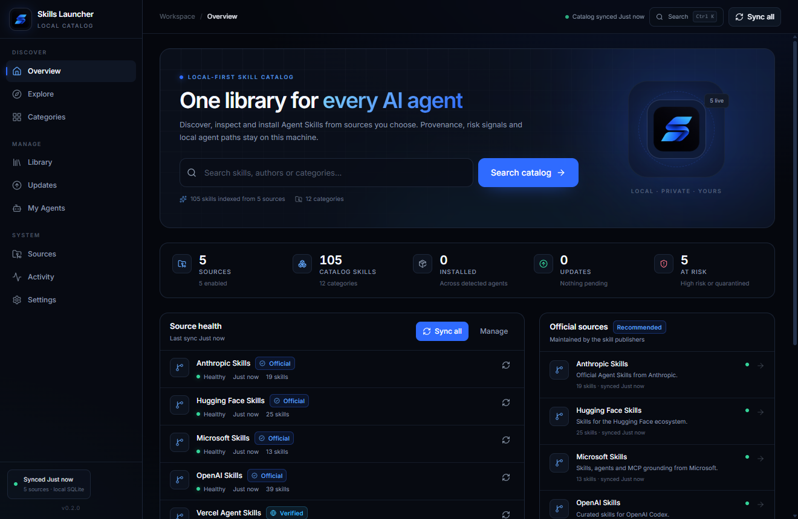

- **Sync all** syncs every enabled source.
- **Sources / Catalog skills / Installed / Updates / At risk** give a quick catalog overview.
- **Source health** shows healthy, failing, and never-synced sources.
- **Featured skills** links to high-quality skills already in the catalog.
- **Recent operations** shows the latest syncs, installs, updates, and removals.

## Explore

Use **Explore** to search and filter the full catalog.

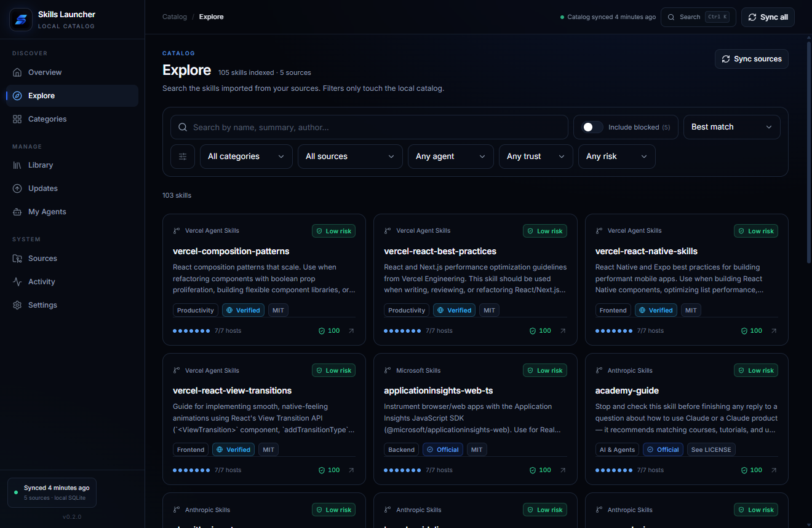

- Search by name, summary, author, or indexed content.
- Filter by category, source, agent, trust, and risk.
- **Include quarantined** reveals versions blocked by the scanner.
- Sorting switches between quality, recently updated, name, stars, and safety.
- Click a card to open the skill detail.

### Search

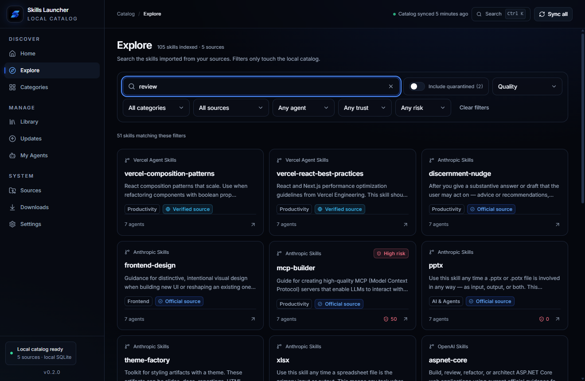

Search is local and never sends your query to a server. Use `Ctrl K` on Windows/Linux or `Cmd K` on macOS to focus
search from another screen.

## Categories

**Categories** groups the catalog by area and opens Explore with the category filter applied.

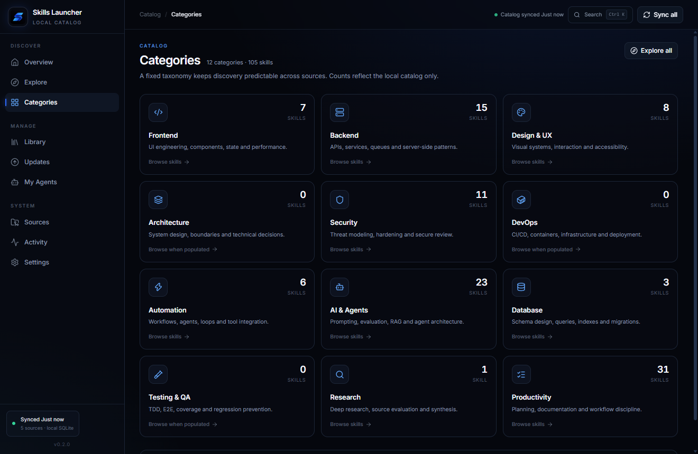

Empty categories are not shown as dead-end shortcuts.

## Skill detail

The side sheet shows everything before you install.

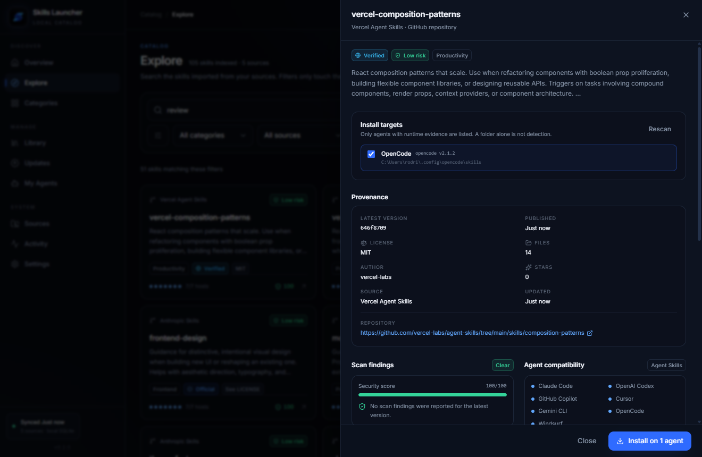

- **Trust / Risk / category**: provenance, risk, and classification.
- **Install targets**: only agents with runtime evidence appear. Select one or more.
- **Provenance**: version, license, author, stars, source, update time, and repository.
- **Scan findings**: scanner results. Click any risk badge to open the scale explanation.
- **Agent compatibility**: known Agent Skills format support.
- **Install on …**: installs on the selected agent. The label becomes **Reinstall** when an installation already exists.

### Risk explanation

Click any risk badge, including badges on cards and scan findings.

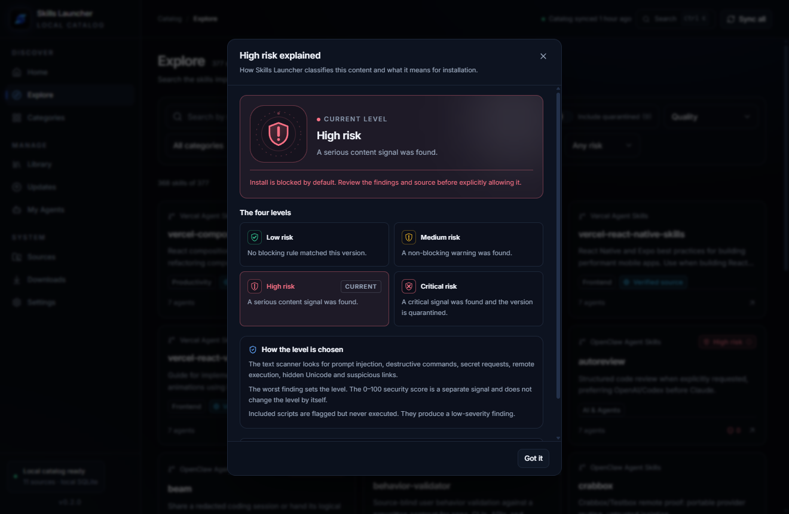

The dialog explains:

- the current level;
- what Low, Medium, High, and Critical mean;
- what happens to installation;
- how the scanner chooses the level;
- that the scan is heuristic, not a guarantee.

`High` requires explicitly allowing the install. `Critical` is quarantined and the UI blocks installation.

## Install a skill

1. Open the skill detail.
2. Review provenance, license, and findings.
3. Select a detected agent under **Install targets**.
4. Click **Install on …**.
5. Open **Library** to confirm.

When replacing an existing folder, the installer creates a backup, stages the new files, swaps them in, and only then
updates the database. Untracked user files are preserved during updates.

## Library

**Library** shows what is installed, where, and at which version. It reads installations created by the app
**and skills that were already on disk before the app was installed**.

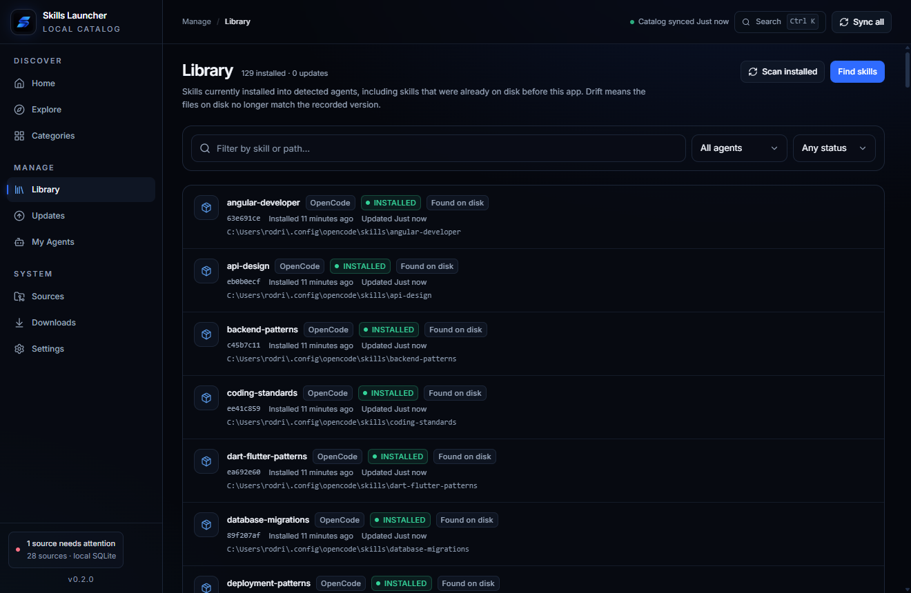

Existing skills appear with the **Found on disk** badge. They are read-only in Library: the app does not update,
rollback or delete them. The scan covers the documented user skill folders for all seven supported agents, even when
the agent executable is not detected. Use **Scan installed** to refresh it. The scan also follows top-level
symlinks/junctions when their target stays inside your home directory.

Each app-managed installation provides:

- **Update** when a newer version exists;
- **Rollback/backups** to restore an earlier version;
- **Uninstall**, with an option to keep or remove installed files.

Uninstall keeps the history and can create a backup before files are removed.

## Updates

**Updates** compares installations with the latest version of each skill.

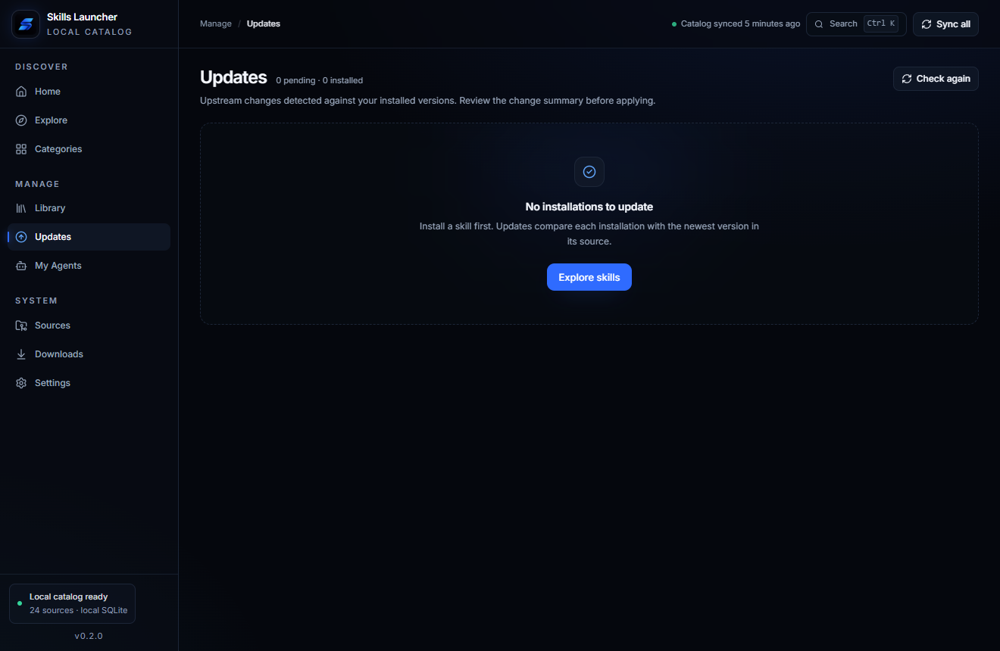

- **Check again** refreshes the comparison.
- Select one or more updates and use **Update selected**.
- Quarantined versions and high/critical risk versions are not auto-updated.

## My Agents

**My Agents** shows only agents with real runtime evidence.

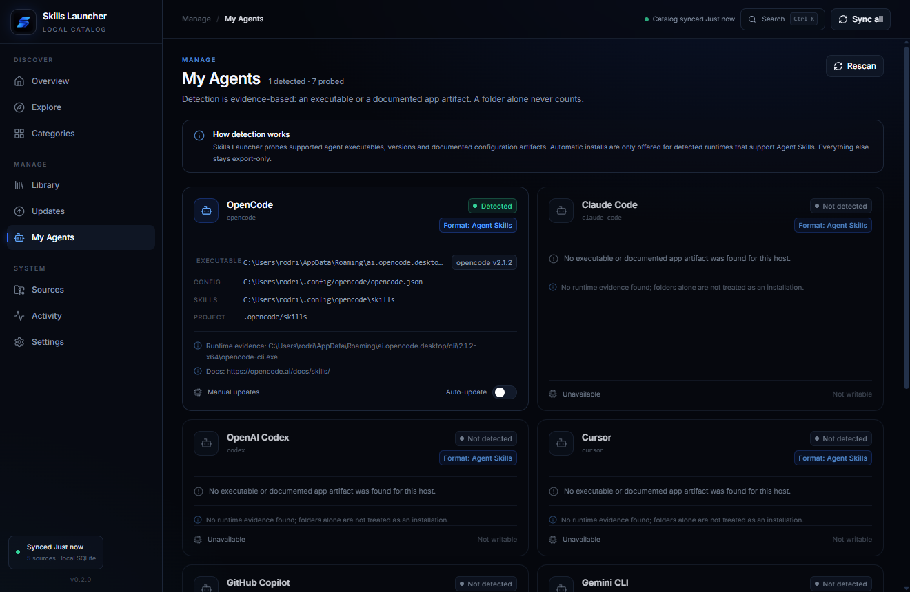

Each detected agent displays:

- executable and version;
- discovered configuration;
- user skills root;
- project skills root;
- evidence notes;
- **Auto-update** switch.

Use **Rescan** after installing or removing an agent. A configuration folder alone is never treated as a detected agent.

Supported agents: Claude Code, OpenAI Codex, OpenCode, Cursor, GitHub Copilot, Gemini CLI, and Windsurf/Devin Desktop.

### Add an agent manually

If an agent is installed in a non-standard location and detection still misses it, use **Add manually**.

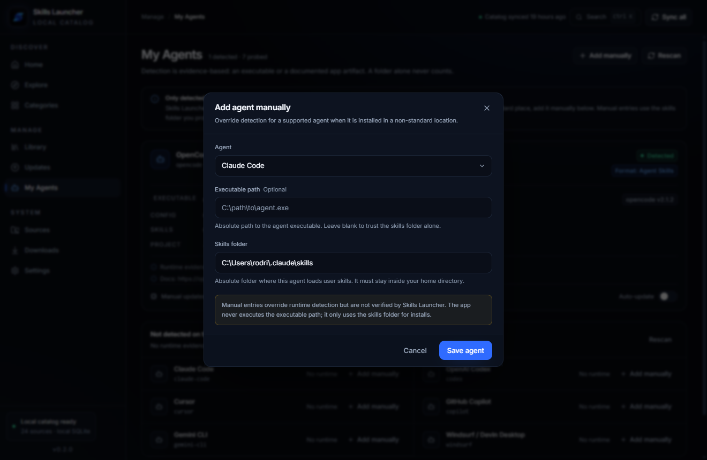

1. Choose the supported agent.
2. Optionally enter the absolute executable path.
3. Set the absolute user skills folder. It must stay inside your home directory.
4. Save. The agent appears as **Manual entry** and can receive installs.
5. Use **Remove manual** when you no longer need the override. It is blocked while that host has installed skills.

Manual entries are not verified by Skills Launcher. The executable path is never executed by the app; only the supplied skills folder is used for filesystem installs.

## Sources

**Sources** feeds the catalog. Every skill keeps provenance from its source.

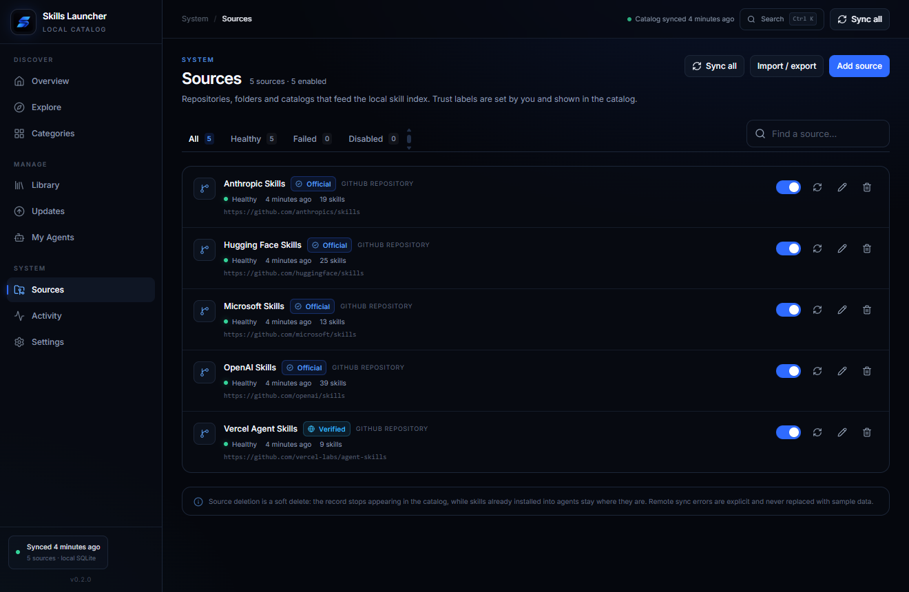

- **Add source** adds a catalog.
- **Import / export** moves source configuration between installations.
- The sync icon refreshes only that source.
- The switch enables or disables the source.
- The pencil edits name, URL, branch, path, trust, and sync policy.
- The trash icon removes the source from the catalog without deleting installed skills.

### Add or edit a source

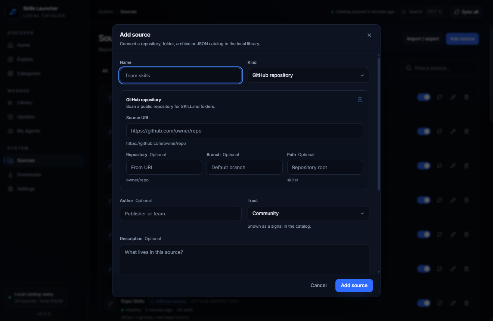

Available source types:

| Type | Use |
|---|---|
| GitHub repository | A public repository containing folders with `SKILL.md`. |
| GitHub organization | Discovers public repositories in an organization. |
| Local folder | A local folder selected with the native picker. |
| ZIP archive | A local ZIP read in memory. |
| Git repository | Shallow clone through the system Git. |
| HTTP JSON catalog | A versioned JSON catalog following the app contract. |

Set a branch/path when `SKILL.md` is not at the repository root. **Trust** is a source-declared label, not a security
signature.

### Import and export sources

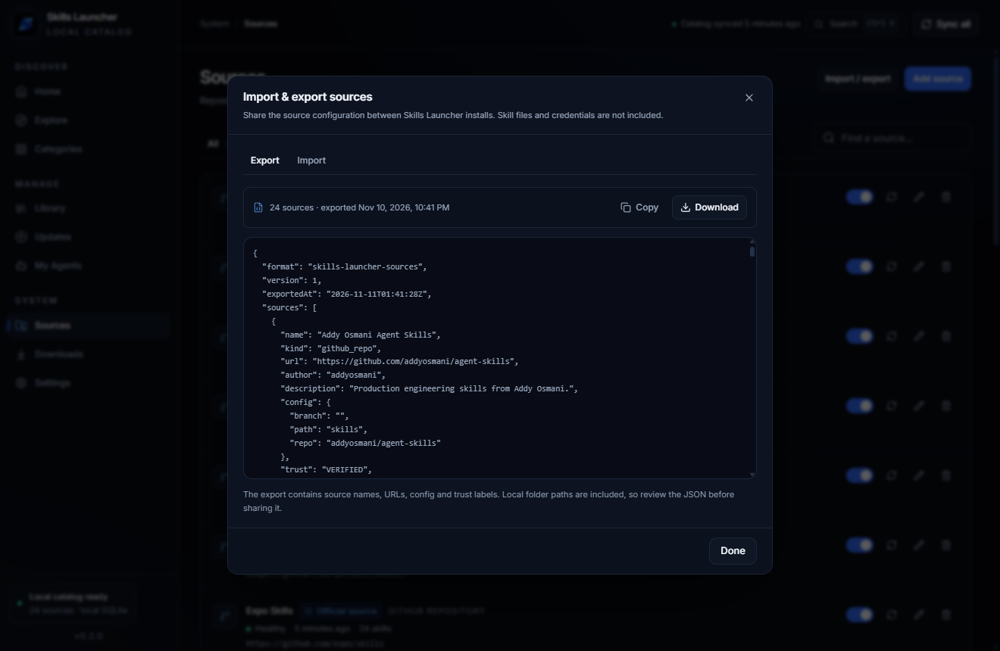

The exported JSON contains names, URLs, configuration, and trust labels. It does not contain skill files or credentials.
Local paths may be included; review the JSON before sharing it.

## Downloads / Operations

**Downloads** is the local operation journal.

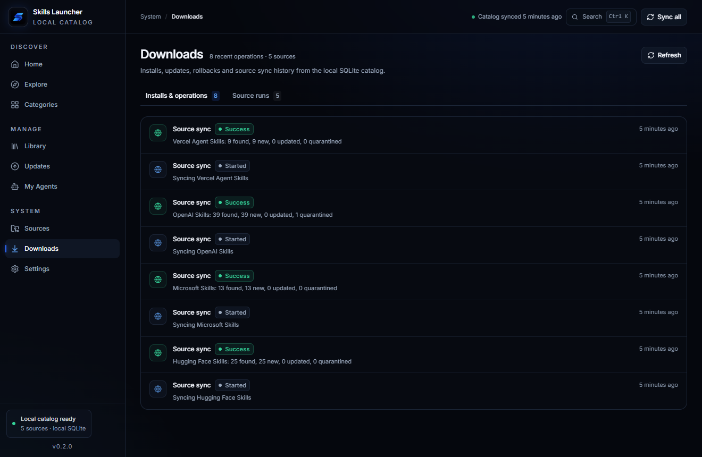

Track syncs, installs, updates, rollbacks, and removals with status and timestamps. Use this screen to diagnose a failed
source or confirm the result of an operation.

## Settings

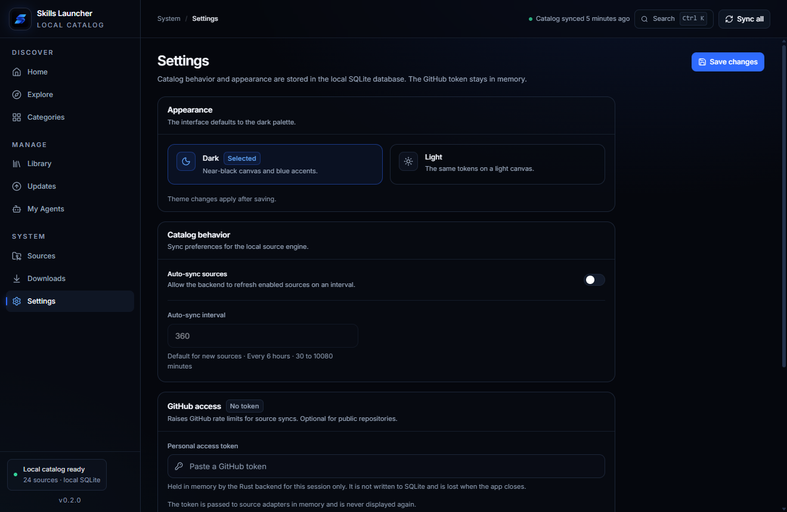

- **Appearance**: switches between dark and light themes.
- **Auto-sync sources**: enables periodic source refreshes.
- **Auto-sync interval**: between 30 and 10,080 minutes.
- **GitHub access**: optional token to raise the rate limit. It is held in memory only and never written to SQLite.
- **Save changes** applies the local settings.
- **User guide with screenshots** opens this document.

### Light theme

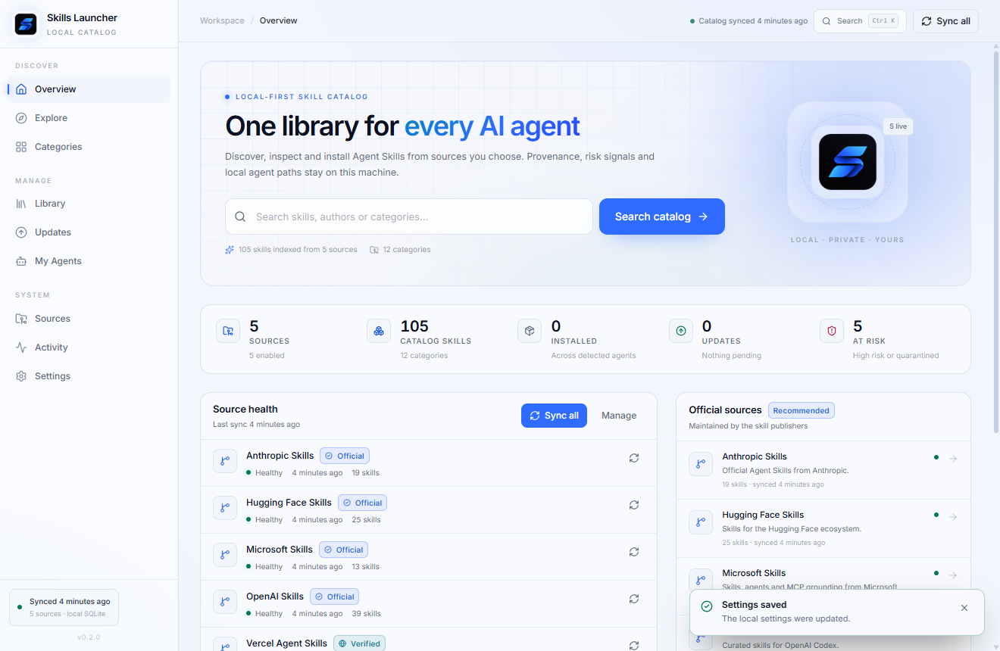

### Compact window

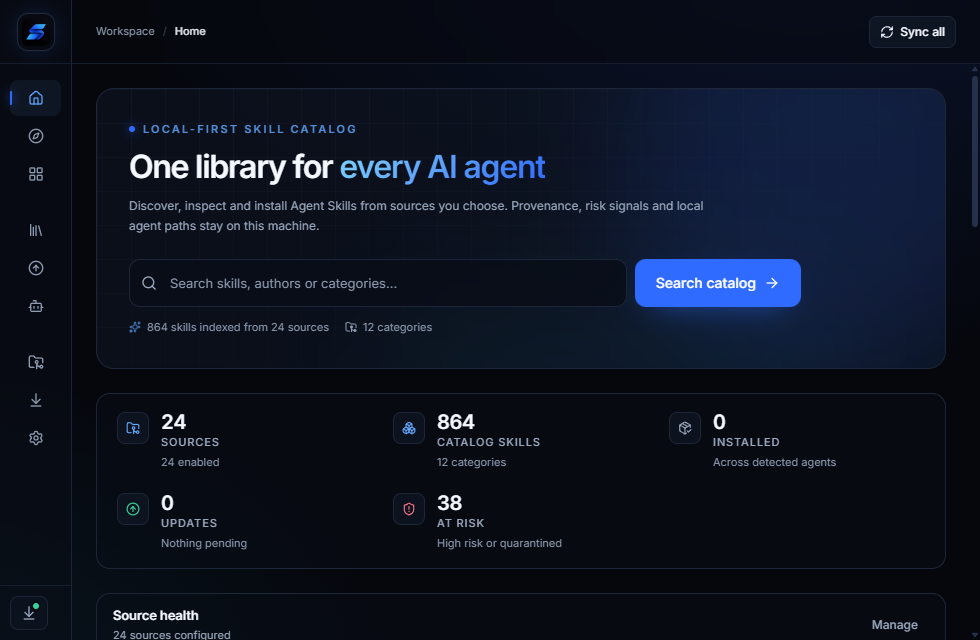

The minimum supported layout is `980x640`; the sidebar collapses when labels no longer fit.

## Security and risk

The scanner examines skill text for prompt injection, destructive commands, secret requests, remote execution, hidden
Unicode, and suspicious links.

- **Low**: no blocking rule matched; this is not a safety guarantee.
- **Medium**: a warning that does not block installation.
- **High**: installation is blocked by default and requires explicit confirmation.
- **Critical**: the version is quarantined and the UI blocks installation.

The 0–100 score is independent of the level. The scanner is heuristic and does not replace reviewing the content and
its source.

## Troubleshooting

- **Agent does not appear**: install the real executable, check `PATH`, and use **Rescan**.
- **Source failed**: check the error in **Sources** and the history in **Downloads**.
- **Cannot install**: confirm the agent was detected, the skill is not quarantined, and there is no unmanaged folder at
  the destination.
- **Update does not appear**: sync the source and use **Check again** in Updates.
- **Undo a change**: open the installation's history in Library, select a backup, and use **Restore backup**.
